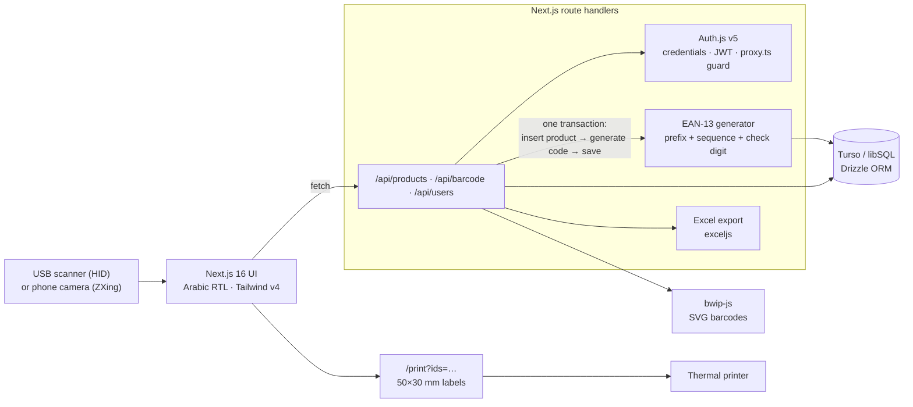
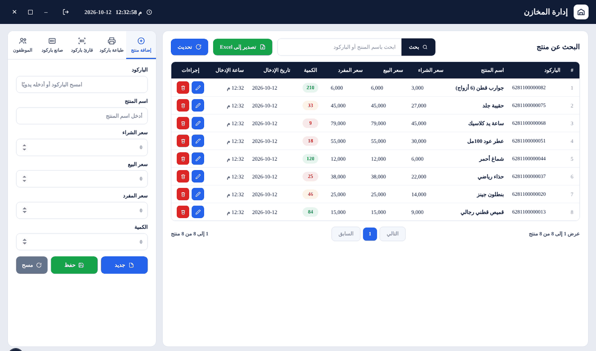
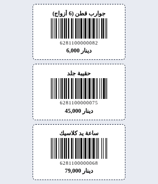
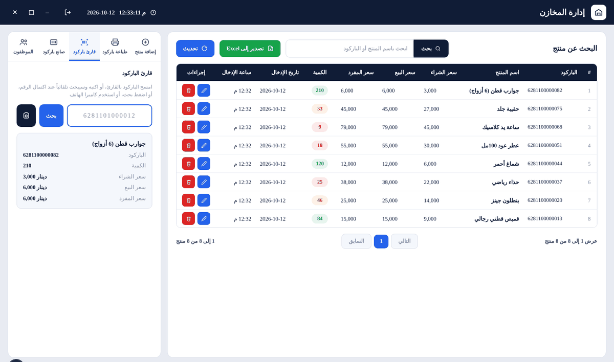

<div align="center">

# Warehouse & Barcode Management System

**Add a product → get a unique EAN-13 barcode → print the label → scan it at the counter.**
An Arabic (RTL) inventory system built for a retail client and running in production.


**[Live demo →](https://warehouse-barcode-system.vercel.app)** &nbsp;·&nbsp; [Architecture](#architecture) · [Screenshots](#screenshots) · [Run locally](#run-locally) · [Tests](#tests)

</div>

> The live instance is the client's production system, so it is behind a login. Demo credentials are available on request.

---

## Features

1. **Add product + automatic barcode.** `POST /api/products` creates the product and, **inside the same database transaction**, generates a unique 13-digit EAN-13 code (6-digit company prefix + 6-digit sequence + computed check digit). The UI shows the digits and the rendered barcode immediately. A barcode can also be typed or scanned manually; the server validates the format and rejects duplicates with `409`.
2. **Print labels.** Select products and print chrome-free 50 × 30 mm labels (name, EAN-13 SVG, digits, price), one per page, ready for any thermal printer through the normal print dialog.
3. **Scan at the counter.** A USB barcode scanner acts as a keyboard, so the scan screen keeps one input permanently focused: scan → `Enter` → product card (name, prices, quantity) → cleared and ready for the next scan.

Also: **phone-camera scanning** (ZXing) for mobile use, full product table, search by exact barcode or partial name, colour-coded stock levels, edit/delete, **Excel export** (RTL sheet), a standalone barcode generator, user roles, an audit log, login rate-limiting and a session guard on every route.

## Architecture



**Why the barcode is generated inside the transaction:** two staff adding products at the same moment can never receive the same code. The check digit is computed per the EAN-13 standard, so labels scan on any retail scanner.

## Screenshots

| Products & barcodes | Label printing | Scanner |
|---|---|---|
|  |  |  |

## Tech stack

Next.js 16 (App Router, Turbopack) · TypeScript · Turso / libSQL · Drizzle ORM + drizzle-kit migrations · Auth.js v5 (credentials, JWT, bcryptjs) · bwip-js (EAN-13 / Code 128 as SVG) · exceljs · Zod 4 · Tailwind CSS v4 · Vitest 4 (unit + integration projects) · Playwright · Vercel

## Run locally

```bash
git clone https://github.com/sami7q/warehouse-barcode-system.git && cd warehouse-barcode-system
npm install
cp .env.example .env
#   TURSO_DATABASE_URL=file:local.db   (no Turso account needed locally)
#   AUTH_SECRET=$(openssl rand -hex 32)
#   BARCODE_PREFIX=628110              (exactly 6 digits)
#   ADMIN_EMAIL / ADMIN_PASSWORD       (your first login)
npx drizzle-kit migrate
npm run seed
npm run dev                            # http://localhost:3000
```

## Tests

```bash
npm run test              # unit + integration (Vitest) — 80 tests
npm run test:unit         # EAN-13 check digit, validation, label size, rate limiting, sessions
npm run test:integration  # products / users / audit APIs against a throwaway SQLite database
npm run test:e2e          # Playwright: auth, roles, print, scan (USB + camera), mobile, audit
```

## Deploy

Turso Cloud for the database and Vercel for the app:

```bash
turso db create warehouse-db
turso db show warehouse-db --url        # → TURSO_DATABASE_URL
turso db tokens create warehouse-db     # → TURSO_AUTH_TOKEN
vercel env add TURSO_DATABASE_URL && vercel env add TURSO_AUTH_TOKEN
vercel env add AUTH_SECRET && vercel env add BARCODE_PREFIX
vercel --prod
```

---

<div align="center">

Built by **Sami Aqeel** · [LinkedIn](https://www.linkedin.com/in/sami-aqeel/) · [GitHub](https://github.com/sami7q) · sami22eng@gmail.com

</div>
